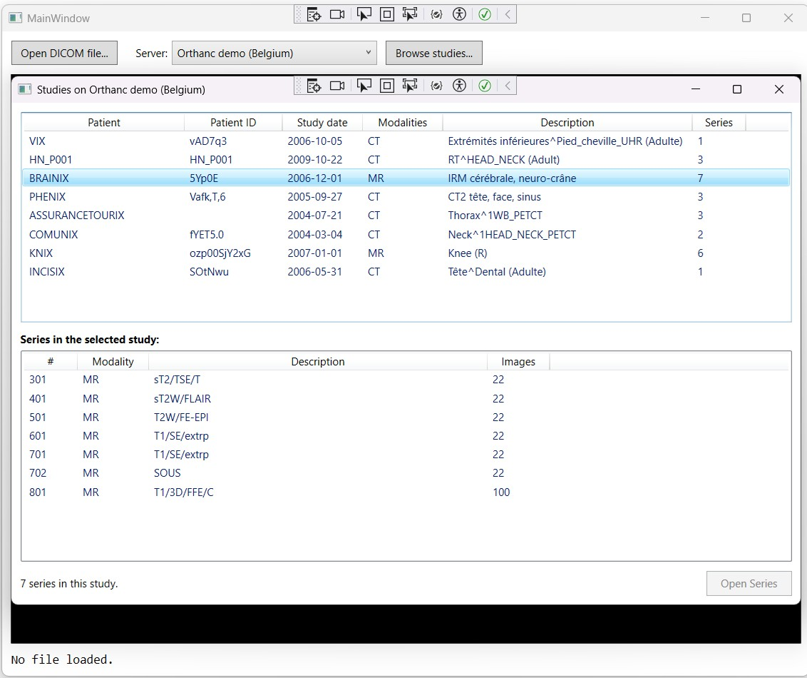
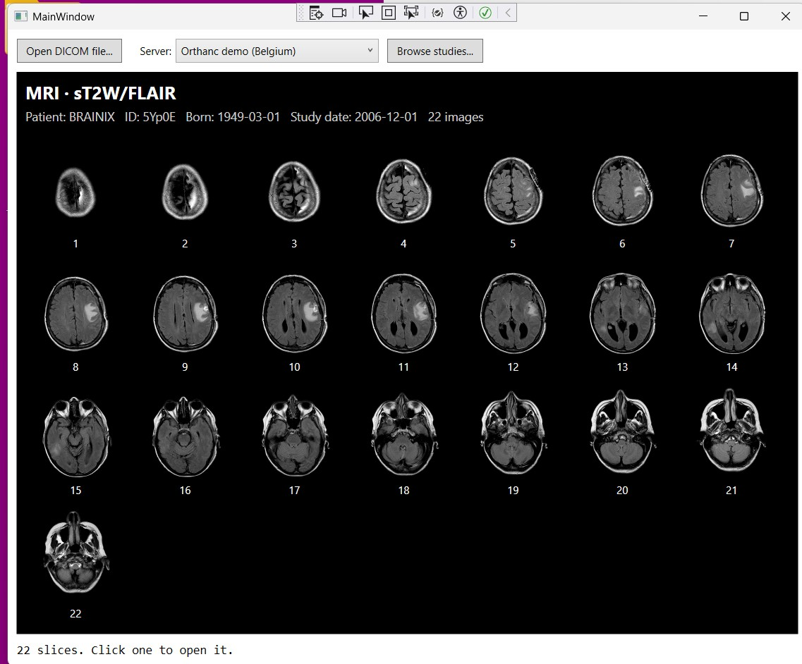
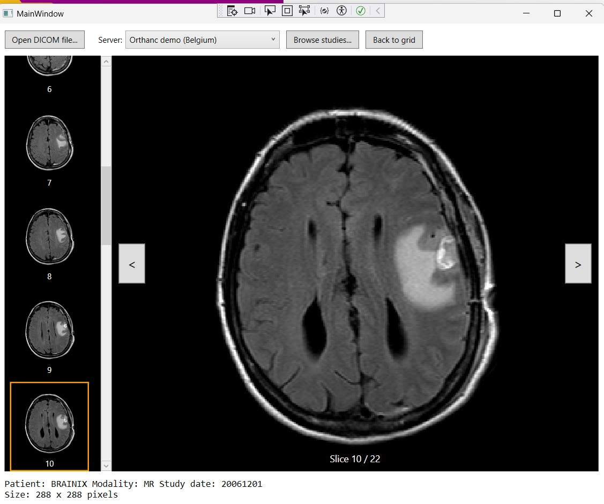
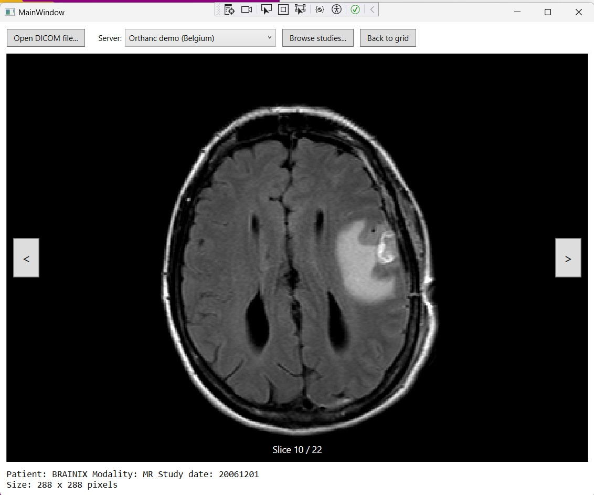

# DicomViewer

A small Windows desktop viewer for medical images (DICOM), written in C# with WPF and
[fo-dicom](https://github.com/fo-dicom/fo-dicom). It opens local DICOM files and browses
real PACS servers over **DICOMweb** (QIDO-RS, WADO-URI, WADO-RS).

Built as a learning project to understand the DICOM standard, PACS workflows and DICOMweb.

<!-- Add screenshots here, e.g.:

-->

## Features

**Viewing**
- Open a local DICOM file (`.dcm`) and render it, including 16-bit CT/MR images and overlays
- Patient, modality, study date and image size read from DICOM tags
- Three view modes for a series:
  - **Grid**: all slices as thumbnails, with a header (modality, series, patient, dates, image count)
  - **Split**: filmstrip on the left, selected slice large on the right
  - **Full**: the selected slice only
- Navigate slices with `<` `>` buttons, the mouse wheel or the arrow keys
- Current slice highlighted in the filmstrip and scrolled into view
- Double-click the large slice to switch between split and full view
- Click empty space in the grid to clear the selection

**PACS / DICOMweb**
- Choose a server from a dropdown
- **Studies window**: search studies with **QIDO-RS** (`/studies`), then the series of a study (`/studies/{uid}/series`)
- Open a series by double-click, Enter or the *Open series* button
- Download each image with **WADO-URI** or **WADO-RS**, depending on the server
- WADO-RS: requests uncompressed DICOM (Explicit VR Little Endian) and unwraps the `multipart/related` response
- Slices sorted by Instance Number (0020,0013)
- Partial downloads: images that fail are skipped, the rest are shown, and the number of failures is reported

## Servers

| Server | Search | Download |
|---|---|---|
| [Orthanc demo](https://orthanc.uclouvain.be/demo/) (UCLouvain, Belgium) | QIDO-RS | WADO-URI |
| [NCI Imaging Data Commons](https://portal.imaging.datacommons.cancer.gov/) public proxy | QIDO-RS | WADO-RS |

Both contain public, de-identified test or research data. The IDC proxy has a daily usage
limit and is intended for viewing, not bulk downloading.

## Requirements

- Windows 10 or 11
- Visual Studio 2022 with the **.NET desktop development** workload
- .NET 9 SDK (installed with Visual Studio)
- NuGet package: `fo-dicom` 5.2.x (restored automatically)

## Build and run

1. Clone the repository
2. Open `DicomViewer.sln` in Visual Studio 2022
3. Press **F5**

## How to use

1. **Local file:** click *Open DICOM file...* and choose a `.dcm` file
2. **From a PACS:**
   1. Choose a server in the *Server* dropdown
   2. Click *Browse studies...*
   3. Click a study to see its series, then double-click a series (or select it and press Enter)
   4. The series downloads and appears in the grid
3. Click a thumbnail to open it; use `<` `>`, the mouse wheel or the arrow keys to move through the slices
4. Double-click the large image for full view; *Back to grid* returns to the thumbnails

Note: series that are not images (for example **SEG** segmentations or **SR** reports)
cannot be displayed. Slide microscopy (**SM**) whole-slide images are not supported.

## Project structure

| File | Purpose |
|---|---|
| `MainWindow.xaml` / `.cs` | Main window: views, navigation, downloading and rendering |
| `StudyBrowserWindow.xaml` / `.cs` | Studies window: QIDO-RS study and series search |
| `PacsServer.cs` | `PacsServer` record and `RetrieveMethod` enum |
| `DicomJson.cs` | Helpers to read values from DICOM JSON (QIDO-RS answers) |

## Roadmap

- [ ] Window/level: right-drag to change contrast, `R` to reset
- [ ] Hide or grey out non-image series (SEG, SR) in the series list
- [ ] Faster downloads (several images in parallel) and a cancel button
- [ ] Stop after several failures in a row (for example when the network is down)
- [ ] Patient name search in the Studies window
- [ ] Support compressed transfer syntaxes (fo-dicom codecs)
- [ ] Whole-slide pathology images (tiled viewing)

## Technologies

C# · .NET 9 · WPF · fo-dicom 5 · System.Text.Json · DICOMweb (QIDO-RS, WADO-URI, WADO-RS)

## Disclaimer

For learning and demonstration only. Not a medical device and not intended for diagnosis.
